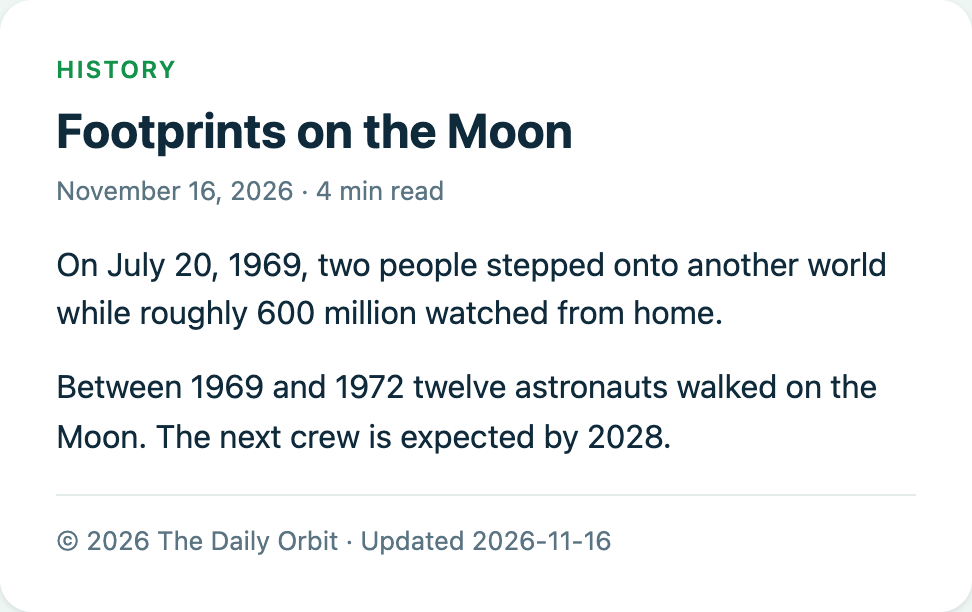
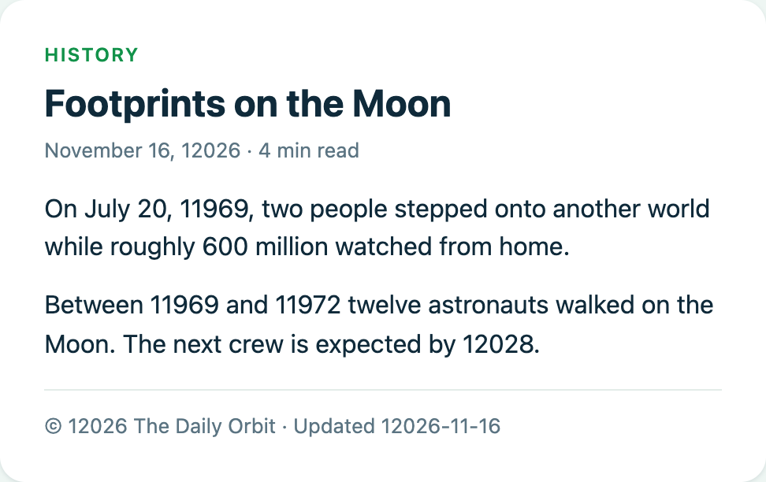
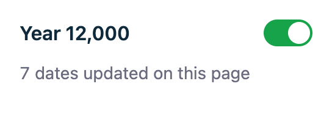

<div align="center">


# Year 12,000

**See every date on the web in the Human Era. 2026 becomes 12026.**

[](https://github.com/c2r0b/year-12000/actions/workflows/tests.yml)


[Why](#why) · [Features](#features) · [Install](#install) · [How it works](#how-dates-are-recognised) · [Development](#development)

</div>

<table>
  <tr>
    <th width="50%">Before</th>
    <th width="50%">After</th>
  </tr>
  <tr>
    <td></td>
    <td></td>
  </tr>
</table>

## Why

Our calendar starts counting about 2,000 years ago, which quietly hides most of the human story. The [Holocene calendar](https://en.wikipedia.org/wiki/Holocene_calendar) adds 10,000 years, so that year one sits roughly where humans started building the first large structures and settling down. Nothing else changes: same months, same days, just one extra digit and a much better sense of how long we have been at this.

### A tribute to Kurzgesagt

This project is in part a tribute to [Kurzgesagt – In a Nutshell](https://www.youtube.com/@kurzgesagt), the YouTube channel that made the idea popular with [*A New History for Humanity – The Human Era*](https://www.youtube.com/watch?v=czgOWmtGVGs) and keeps it alive every year with its Human Era calendar. It is a fan project and is not affiliated with or endorsed by Kurzgesagt.

## Features



- **Every kind of date.** `November 16, 2026`, `2026-11-16`, `16/11/2026`, `© 2026`, `1939–1945`, `the 1990s`, `mid-2026`, in six languages.
- **Careful with plain numbers.** `2000 people`, `$1999` and `Room 2026` stay as they are. A bare number is converted only when the text, the line or the table around it points to a year.
- **Visual only.** Form fields, date pickers, drop-downs, editable text and code blocks are never touched, so forms submit exactly what they did before.
- **The whole page.** Content that loads as you scroll, web components (shadow DOM), tooltips and the tab title are converted too.
- **One switch.** On or Off, plus a counter for the current page. Switching off restores the original text immediately.
- **Private.** No network requests, no analytics, and only the `storage` permission, used to remember the switch.

## Install

The extension is not on the Chrome Web Store yet. To load it from source:

1. Download or clone this repository.
2. Open `chrome://extensions` (or the equivalent page in Edge, Brave, Vivaldi, Opera, Arc).
3. Turn on **Developer mode**.
4. Click **Load unpacked** and select this folder.
5. Reload the tabs that were already open.

## How dates are recognised

A number is only a year when something says so. Dates with a recognisable shape are always converted:

| Pattern | Example | Years covered |
| --- | --- | --- |
| Numeric dates | `2026-11-16`, `16/11/2026`, `11/2026` | 0000–9999 |
| Dates with a month name | `Nov 16, 2026`, `July 16–24, 1969`, `16 novembre 2026` | 0000–9999 |
| Decades | `the 1990s`, `1990's`, `die 1990er` | 1000–2099 |
| Hyphenated prefixes | `mid-2026`, `pre-2020`, `post-1945` | 1000–2099 |

Month names are recognised in English, in your browser languages and in the language of the page.

A number on its own, between 1000 and 2099, is converted only when its surroundings point to a year:

| Evidence | Converted | Left alone |
| --- | --- | --- |
| A word that introduces a year | `the year 2000`, `since 1998`, `© 2026`, `Summer 2026` | |
| A range or a list of years | `1939–1945`, `2024, 2025 and 2026` | `1500, 2000 and 1000` |
| Brackets | `Inception (2010)` | |
| A preposition | `in 2026`, `the 2026 budget`, `by 2030` | `of 2000 respondents`, `the 1500 participants` |
| A definite article after it | `received 1385 the charter` | `costs 1500 a month` |
| Its place in a title | `World Cup 2026`, `2024 Annual Report` | `Odyssey 2000`, `Total 1500` |
| Standing alone in its element | `2026` in a table cell or a `<time>` tag | `1500` in a table cell |
| The header of its table column or row | `1500` under "Year" or "Founded" | `2026` under "Price" or "Population" |

Whatever the evidence, a number is never converted when it reads as a quantity or a label: `2000 people`, `1500 km`, `about 2000`, `$1999`, `2026%`, `Room 2026`, `Flight 1549`, `Windows 2000`, `555-2026`, `1200 BC`. Round and very old numbers (`2000`, `1500`, `1066`) are more often quantities than years, so they need the stronger kinds of evidence.

The evidence is read across the whole line, not only the element that holds the number: in `<b>since</b> 1500` the word counts, and in `<span>2026</span> <em>people</em>` so does the unit. It never crosses into another paragraph, table cell or line.

The context words are available in English, Italian, Spanish, French, German and Portuguese, and live in [`lexicon.js`](lexicon.js), one list per language.

### Accuracy

The rules are measured against a [hand-labelled corpus](test/corpus) of Wikipedia text in those six languages: 117 years and 15 other four-digit numbers (heights, distances, areas). Currently 116 of the years are converted (99.1% recall) and none of the other numbers (100% precision). `npm run corpus` prints the report, and the tests fail if accuracy drops.

Take the figure for what it is: encyclopedia prose is friendly ground, because most of its four-digit numbers are years. Shops, dashboards and forums are harder and are not in the corpus yet.

## Limitations

- The rules prefer missing a year to rewriting a quantity, so some real years stay as they are, for example in `in 2026 people will…`, where "2026 people" reads as a count.
- Languages outside the six above get full dates, decades and structural evidence, but no context words.
- On pages declared as German, where nouns are capitalised, a number followed by a lowercase word is read as a year more readily. A sentence such as `kostet 1985 und…` would be converted.
- Years before 1000 are only converted inside a full date, and BC/BCE years are not handled.
- Two-digit years (`11/16/26`, `'90s`) are not converted.
- Dates drawn inside images, videos and canvases are not changed.
- Copying text copies the converted year, and so do bookmarks and browser history, which store the converted tab title.

## Development

The extension has no build step: the browser loads the files as they are. Node.js is only needed for the tests and for rendering the images.

```sh
npm install
npx playwright install chromium
```

| Command | What it does |
| --- | --- |
| `npm test` | Runs both test suites |
| `npm run test:unit` | Tests the date rules in Node, including the corpus thresholds |
| `npm run test:e2e` | Tests the real extension in Chromium, via Playwright |
| `npm run corpus` | Prints accuracy on the labelled corpus, with every miss |
| `npm run package` | Builds the Chrome Web Store zip in `dist/` |
| `npm run icons` | Re-renders the PNG icons from `icons/icon.svg` |
| `npm run screenshots` | Retakes the README screenshots from the running extension |

Both test suites run in [GitHub Actions](.github/workflows/tests.yml) on every push and pull request.

### Releasing

```sh
npm version patch   # or minor / major: bumps package.json and manifest.json, commits and tags
git push --follow-tags
```

The tag starts the [release workflow](.github/workflows/release.yml): it runs the tests, builds the zip with only the runtime files, submits it to the Chrome Web Store for review and attaches the same zip to a GitHub release. `npm run package` builds that zip locally in `dist/`.

The workflow needs a GitHub environment named `chrome-web-store` with the variables `CWS_PUBLISHER_ID` and `CWS_EXTENSION_ID` and the secret `CWS_SERVICE_ACCOUNT_KEY` (the JSON key of the Google service account added to the publisher account). Running the workflow by hand from the Actions tab only checks that these credentials work.

### Project layout

| Path | Purpose |
| --- | --- |
| `manifest.json` | Extension manifest (Manifest V3) |
| `lexicon.js` | Context words, per language |
| `dates.js` | Finds and converts years in a string |
| `content.js` | Applies the conversion to the page and undoes it |
| `popup.*` | The On/Off switch and the counter |
| `icons/` | `icon.svg` and the PNG sizes rendered from it |
| `docs/` | README screenshots |
| `scripts/` | Image generation, corpus tools, packaging and publishing |
| `test/unit/` | Tests for the date rules |
| `test/corpus/` | Labelled real-world text and its scoring |
| `test/e2e/` | Tests that load the extension in Chromium |

## Contributing

Issues and pull requests are welcome. The most useful reports are short snippets of text where a year was missed or a quantity was rewritten: each one becomes a test. New languages are welcome too: add a block to `lexicon.js` and an article or two to the corpus (see [`test/corpus`](test/corpus)). Please run `npm test` before opening a pull request.

## Acknowledgements

- [Kurzgesagt – In a Nutshell](https://www.youtube.com/@kurzgesagt), for the video and the calendars that inspired this.
- Cesare Emiliani, who proposed the Holocene calendar in 1993.
